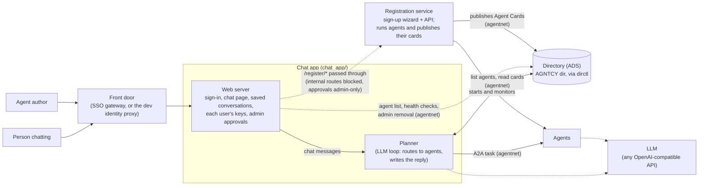

# AgenticNetwork

AgenticNetwork is a research system for an **"Internet of Agents"**: like the web, where anyone
can publish a page and anyone can visit it, anyone can add an agent here and anyone can use it.
An author registers an agent once: a no-code LLM agent, a wrapper around an existing API, or
uploaded code (which an admin approves first). From then on every signed-in user can reach it
from one chat window, with no change to the rest of the system.

Between a user's prompt and the agents that answer it sits **routing**: deciding which agents
the prompt needs. Today that job belongs to the **planner**, an LLM agent inside the **chat
app**, the one web service people sign in to; later it could be any routing algorithm. Agents
are found through a shared **directory**: each one publishes an Agent Card describing its
skills, and a caller (today the planner, and a few hand-built agents) reads the cards and sends
the task to the chosen agent over **A2A**, a standard agent-to-agent protocol. A new agent is usable as soon as its card
is published, with no planner code changes.

## How it works



The chat app is the only service people reach directly. It signs people in, serves the chat
page, keeps saved conversations and each user's encrypted keys, runs the admin pages (including
approving new agents), and files bug reports.

The **planner**, inside the chat app, handles every chat message. It has two jobs today:
**routing**, which means choosing the agent a message needs and sending it the task, and
**responding**, which means writing the reply the user sees from what the agent returned (or
asking the user a question first). It is an LLM loop whose model sees five tools: `list_agents`
and `describe_agent` to search the directory and read cards, `call_agent` to send an A2A task,
and `ask_user` and `final_answer` to reply. A request goes browser → front door (which adds the
user's identity) → chat app → planner → directory search → A2A call to the chosen agent → answer
back to the user.

Agent authors use a separate place, the registration service's sign-up wizard, to register an
agent; the registration service then runs the agent (once an admin approves it, for uploaded
code) and publishes its card to the directory. Both sit at the same public address: the chat
app's web server passes `/register/*` requests through to the registration service (it blocks the
service's internal routes and checks admin rights for approvals), and the planner's LLM is not
involved. So the registration service never needs a public port and stays behind the same
sign-in.

`agentnet` is not a service: it is the shared library that the chat app and the registration
service use for every directory and A2A call. In the chat app, the planner uses it to search the
directory and call agents, and the web server uses it to list agents, check their health and
remove them (admin). Agents registered through the registration service run on
`agent_skeleton`, the agent runtime; standalone agents can be written any way that speaks A2A.

**Key ideas**

- **Agent Card**: a JSON description of an agent (name, endpoint URL, skills, and any credentials it needs).
- **Directory (ADS)**: the AGNTCY `dir` service, driven by the `dirctl` CLI; agents publish cards there, and the planner lists them (best match first when it passes a query) and reads their skills to choose one.
- **A2A**: the agent-to-agent protocol (HTTP/JSON-RPC, the `a2a-sdk` package) the planner uses to send a task to an agent.
- **Credential scoping**: users store API keys and OAuth tokens encrypted; the planner passes an agent only the credential types it declared and the user granted, in the A2A task metadata, never through the LLM.

Deeper: [`docs/ARCHITECTURE.md`](docs/ARCHITECTURE.md) and [`docs/AUTH.md`](docs/AUTH.md).

## Quickstart (dev stack)

One command runs the whole system on a laptop: the chat app (with its planner), the
registration service, a seed agent, a mock LLM and a local sign-in proxy. It runs on macOS and Linux. You need Python 3.11 or
newer as `python3` (check with `python3 --version`; macOS's built-in `/usr/bin/python3` is 3.9 and
fails with "No matching distribution found for a2a-sdk"). If your 3.11+ interpreter has another
name, such as `python3.12`, use it for the `-m venv` command and set `DEVSTACK_PYTHON` to it.
From the repo root:

```bash
# One-time setup: one dev venv for both services and every test suite
python3 -m venv .venv && .venv/bin/pip install -r requirements-dev.txt
scripts/stack doctor                # checks Python, the dev venv, the fake dirctl and ports

scripts/stack up                    # returns when everything is ready
open http://localhost:8080/app      # chat UI, signed in as dev@example.test (macOS; elsewhere open the URL in a browser)
scripts/stack smoke                 # optional: one prompt through the front door
scripts/stack down

scripts/stack test                  # every test suite (docs/TESTING.md)
```

Try "Echo this back: hello": the planner finds the seed agent and returns its answer. No Docker,
database, SSO or API key is needed; the LLM is an offline mock by default. A real LLM, adding
agents, logs and troubleshooting: [`docs/DEVSTACK.md`](docs/DEVSTACK.md).

## Deployment

| Where | Guide | What it is |
|---|---|---|
| Laptop | [`docs/DEVSTACK.md`](docs/DEVSTACK.md) | Native processes from the checkout, mock LLM, no Docker. For development and trying it out. |
| One host or a cloud VM | [`docs/deployment/COMPOSE.md`](docs/deployment/COMPOSE.md) | Docker Compose on a single machine. |
| Google Cloud | [`docs/deployment/gcp/DEPLOY_YOUR_OWN.md`](docs/deployment/gcp/DEPLOY_YOUR_OWN.md) | Your own Google Cloud Run instance. |
| HPC cluster (example) | [`docs/deployment/engr/README.md`](docs/deployment/engr/README.md) | Slurm + Pyxis/enroot, one container per service: the WashU deployment's runbook. |

The images, entrypoints and launch scripts are in [`deployment/`](deployment/); an overview of the
targets is in [`docs/deployment/README.md`](docs/deployment/README.md).

The chat app deploys as `chat-app` everywhere: the image `agenticnetwork-chat-app` (built from
`deployment/dockerfiles/Dockerfile.chat-app`), the Compose service, the cluster's Slurm step and
the Cloud Run service. Before 2026-10-25 these were all named `planner`.

## Testing

All suites, including a full-chain test of the running stack, run offline (no Docker, database, `dirctl` or API key): see [`docs/TESTING.md`](docs/TESTING.md).
What to run before a pull request, and what CI checks, is in [`CONTRIBUTING.md`](CONTRIBUTING.md).

## Repository layout

| Path | What it is |
|---|---|
| [`chat_app/`](chat_app/README.md) | The chat app, the web service people sign in to and chat in (port 8090): sign-in, chat page, saved conversations, each user's keys, admin pages and the `/register/*` pass-through. The planner, the LLM loop that routes messages to agents and writes the reply, is inside it in `chat_app/planner/`. |
| [`registration_service/`](registration_service/README.md) | The registration service (port 8091): a sign-up wizard and REST API where agent authors register agents. It also builds and runs those agents, monitors them and publishes their cards. |
| [`agent_skeleton/`](agent_skeleton/README.md) | The agent runtime that registered agents run on, plus a small demo agent in `agent_skeleton/demo/` (the one part that is safe to edit). |
| [`agentnet/`](agentnet/README.md) | Shared library for the directory (ADS) and A2A calls, used by the chat app and the registration service; plus operator tooling to publish, inspect, diagnose and repair directory records (`scripts/ads`). |
| [`devstack/`](docs/DEVSTACK.md), [`scripts/stack`](scripts/stack) | The dev stack (mock LLM, fake `dirctl`, dev identity proxy, seed agents) and its CLI. |
| [`requirements-dev.txt`](requirements-dev.txt) | The one development environment (`.venv`): both services' requirements, the agent runtime and the test tools. |
| [`tests/pipeline/`](tests/pipeline/) | Full-chain test that drives the dev stack over HTTP. |
| [`deployment/`](deployment/README.md) | Dockerfiles, entrypoints, Slurm and Google Cloud scripts, config templates. |
| [`docs/`](docs/README.md) | Documentation. |
| [`.github/workflows/`](.github/workflows/) | CI: unit suites with coverage, repo hygiene, full-chain and scenario tests (`tests.yml`); the Docker Compose smoke test (`compose.yml`). |

The specialist agents of the WashU deployment (email and calendar, web research, photo
geolocation, coding, intelligence briefs, disaster response) live in a separate repository,
[`agent-directory`](https://github.com/washu-dev/agent-directory). This repository runs on its
own: the dev stack registers a seed agent, and the registration service adds more.

## Documentation

Start at [`docs/README.md`](docs/README.md), a map of every doc grouped by audience: users, agent
builders, contributors and operators. [`AGENTS.md`](AGENTS.md) is a single-file system guide with the working
rules (written for coding agents, useful to people too); [`CLAUDE.md`](CLAUDE.md) only imports it.

## Using the WashU deployment

WashU runs an instance at **https://agenticweb.engr.wustl.edu** (WashU login required).

1. **Sign in** with **Sign in with WashU** (WashU SSO; there is no separate password).
2. **Chat.** Describe a task in plain language. The planner picks the agents; you don't.
3. **Connect accounts and keys** in **Settings → Credentials** when an agent needs your Google
   account or an API key. Keys are encrypted. An agent that declares a key gets it only for your
   requests, after you allow it the first time; a few older agents are exceptions (see
   [`SECURITY.md`](SECURITY.md) §2).
4. **Admins** (emails in the `ADMIN_EMAILS` allowlist) also see a dashboard with agent health,
   request traces and approval of uploaded custom agents. Other users never see admin pages.

## Contributing

See [`CONTRIBUTING.md`](CONTRIBUTING.md) for setup, tests, CI and pull requests, and
[`docs/BUILDING_AGENTS.md`](docs/BUILDING_AGENTS.md) to add an agent.

## Security

Report vulnerabilities privately, as described in [`SECURITY.md`](SECURITY.md), which also covers
the security model and known limitations. This is research software: read that file before you
expose an instance to other users.

## License

No license has been chosen yet. A license will be added before the public release.

## Acknowledgements

Built at Washington University in St. Louis.
