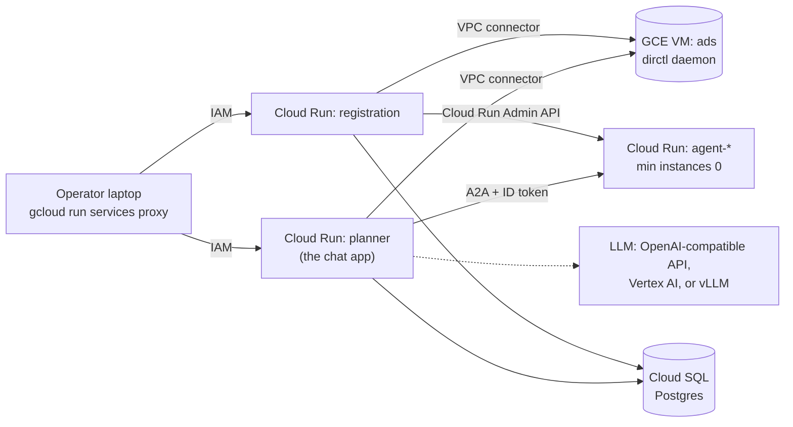

# Deploy your own instance on Google Cloud Run

A step-by-step guide to running AgenticNetwork in your own Google Cloud project. It generalizes
the WashU instance described in [README.md](README.md) and [DEPLOYED_COMPONENTS.md](DEPLOYED_COMPONENTS.md):
same images, same services, your names.

> **Status (2026-10-15).** This guide is derived from the summer-2026 reference deployment, which
> ran live and was verified end to end on 2026-08-03 (planner and registration service on Cloud
> Run with Cloud SQL, a directory VM, and registered agents auto-deployed by the `CloudRunBackend`).
> The commands below generalize that deployment. **Nobody has run them end to end on a fresh
> project.** What is unverified:
>
> 1. The full sequence on a fresh project, and the teardown commands.
> 2. Images in Artifact Registry. The reference pulled every image from Docker Hub.
> 3. The directory VM's machine type and startup script. The reference recorded only its Docker
>    commands and the firewall fix.
> 4. Vertex AI as the *primary* LLM, and the Vertex base URL (taken from Google's documentation,
>    not this repo). The reference used Vertex only as the fallback behind vLLM.
> 5. A hosted OpenAI-compatible API as the planner's LLM on Cloud Run.
> 6. Whether the chat app needs `--vpc-egress=all-traffic` to reach agents deployed with internal
>    ingress (see [Troubleshooting](#troubleshooting)). The reference docs don't record the
>    chat app's egress setting.
> 7. Publishing an agent card by hand over an SSH tunnel ([step 13](#13-add-agents)).
>
> If you run this guide, please fix what breaks and update this box.

## What you get

- **Cloud Run `planner`**: the chat app, the web service people sign in to and chat in (chat UI,
  saved conversations, each user's keys, admin pages), with the planner inside it. The planner
  finds agents in the directory and calls them over A2A, attaching a Google ID token for
  `*.run.app` agents (`agentnet/a2a/transport.py`, `CloudRunIdTokenAuth`). The service keeps the
  chat app's older name, `planner`, as do its image (`agenticnetwork-planner`), the `PLANNER_SA`
  and `PLANNER_INVOKER_SA` settings and the `planner-connector` connector, so existing
  deployments keep working.
- **Cloud Run `registration`**: the registration service, run as a singleton with
  `SPAWN_BACKEND=cloudrun`. When a registered agent's image is ready, its `CloudRunBackend` deploys
  the agent as its own Cloud Run service and publishes the agent's card to the directory
  (`registration_service/backend.py`).
- **Cloud Run `agent-<name>`**: one service per registered agent, scaled to zero when idle.
- **GCE VM `ads`**: the AGNTCY directory (`dirctl daemon`) with a local OCI registry.
- **Cloud SQL** Postgres: one `registration` database shared by the chat app and the registration
  service (they use separate tables).
- **Secret Manager** for keys, a **Serverless VPC Access connector** so Cloud Run can reach the
  private VM, and an LLM of your choice.

Everything is IAM-private: there is no public URL. Operators reach the chat app and the registration
service through `gcloud run services proxy`.



For how this maps onto the HPC cluster deployment, see the comparison table in
[README.md](README.md#how-it-differs-from-the-engr-cluster).

## Prerequisites

- The [`gcloud` CLI](https://cloud.google.com/sdk/docs/install), logged in (`gcloud auth login`).
- Docker with `buildx`, to build `linux/amd64` images (`deployment/build_and_push.sh` sets the
  platform; on Apple Silicon the build runs under emulation and is slow).
- A Google Cloud project with **billing enabled**, and a `default` VPC network in auto mode (new
  projects normally have one; some organizations disable it).
- **Project Owner**, or at least these roles: `roles/resourcemanager.projectIamAdmin`,
  `roles/run.admin`, `roles/secretmanager.admin`, `roles/iam.serviceAccountAdmin`,
  `roles/cloudsql.admin`, `roles/compute.admin`, `roles/artifactregistry.admin`. Editor is not
  enough: it cannot change IAM policies, which several steps do (the reference hit this repeatedly;
  [MIGRATION.md](MIGRATION.md#operational-gotchas-learned--these-bit-us)).
- Quotas: the deployment needs two always-on Cloud Run services, one small VM, one `db-f1-micro`
  database and one VPC connector. A new project's default quotas should cover that; if a create
  command fails on quota, request an increase under IAM & Admin > Quotas.
- To register agents ([step 13](#13-add-agents)): a GitHub repository with the custom-agent build
  workflow, a GitHub token that can write to it, and a public Docker Hub namespace.
- A budget with alerts on the billing account. Alerts notify; they don't stop spending, so every
  deploy below also sets `--max-instances`.

## 1. Set variables once

Run these in the shell you'll use for every later step. They are shell variables for this guide's
commands only; the services' own settings are the env vars passed with `--set-env-vars` and
`--set-secrets` in steps 9 and 10.

```bash
export PROJECT_ID=my-project
export REGION=us-central1
export ZONE=us-central1-a
export ADMIN_EMAIL=you@example.com              # becomes ADMIN_EMAILS on the registration service

gcloud config set project "$PROJECT_ID"
export PROJECT_NUMBER=$(gcloud projects describe "$PROJECT_ID" --format='value(projectNumber)')

export IMAGE_PREFIX="${REGION}-docker.pkg.dev/${PROJECT_ID}/agenticnetwork"   # infra images
export SQL_INSTANCE=agenticnetwork-db
export SQL_CONN="${PROJECT_ID}:${REGION}:${SQL_INSTANCE}"
export CONNECTOR=planner-connector
export CONNECTOR_RANGE=10.8.0.0/28              # must be outside 10.128.0.0/9 (see step 7)

export AGENT_SA="agent-runtime@${PROJECT_ID}.iam.gserviceaccount.com"
export REG_SA="registration-service@${PROJECT_ID}.iam.gserviceaccount.com"
# The chat app's runtime identity. The reference used the default Compute Engine SA; a dedicated
# least-privilege SA is the recommended hardening (untested here; create it and set it instead).
export PLANNER_SA="${PROJECT_NUMBER}-compute@developer.gserviceaccount.com"

# Only for registering agents (step 13):
export DOCKERHUB_NAMESPACE=my-dockerhub-user    # becomes IMAGE_REGISTRY on the registration service
export GITHUB_REPO=example-org/agent-directory  # repo holding the custom-agent build workflow
```

## 2. Enable APIs

```bash
gcloud services enable run.googleapis.com sqladmin.googleapis.com secretmanager.googleapis.com \
  artifactregistry.googleapis.com compute.googleapis.com vpcaccess.googleapis.com iam.googleapis.com
# Only if you use Vertex AI for the LLM (step 10):
gcloud services enable aiplatform.googleapis.com
```

## 3. Build and push the images

The same Dockerfiles serve the cluster and Cloud Run (`deployment/dockerfiles/`). You need three
images: `ads`, `planner` (the chat app) and `registration`. The `postgres` image is not needed;
Cloud SQL replaces it.

```bash
gcloud artifacts repositories create agenticnetwork --repository-format=docker --location="$REGION"
gcloud auth configure-docker "${REGION}-docker.pkg.dev"

# From the repo root. Pushes ${IMAGE_PREFIX}/agenticnetwork-<name>:latest
IMAGE_REGISTRY="$IMAGE_PREFIX" bash deployment/build_and_push.sh ads planner registration
```

`build_and_push.sh` also reads `IMAGE_TAG` (default `latest`) if you want versioned tags. To use
Docker Hub instead of Artifact Registry, as the reference did, set `IMAGE_PREFIX` to your Docker Hub
namespace and skip the first two commands.

## 4. Service accounts and IAM

`deployment/scripts/gcp_iam_step7.sh` creates two service accounts and their grants:

- `agent-runtime`: the low-privilege identity every deployed agent runs as. Gets
  `roles/aiplatform.user` (Vertex).
- `registration-service`: the registration service's identity, which deploys agents. Gets
  `roles/run.admin` (create services and set each one's invoker policy) and
  `roles/iam.serviceAccountUser` on `agent-runtime` only.

`GCP_PROJECT` is required (the script stops if it is unset).

```bash
GCP_PROJECT="$PROJECT_ID" GCP_REGION="$REGION" bash deployment/scripts/gcp_iam_step7.sh
```

The script ends by describing the `planner` service to print its identity. Before step 10 that
last command fails because the `planner` service doesn't exist yet; the grants above it are
already applied.
You don't need its output: `PLANNER_SA` is set in step 1.

Both services connect to Cloud SQL:

```bash
for sa in "$REG_SA" "$PLANNER_SA"; do
  gcloud projects add-iam-policy-binding "$PROJECT_ID" \
    --member="serviceAccount:${sa}" --role=roles/cloudsql.client --condition=None
done
```

Secret access is granted per secret in step 6. The chat app gets `run.invoker` on each agent
automatically: the `CloudRunBackend` grants it to `PLANNER_INVOKER_SA` when it deploys the agent.

## 5. Cloud SQL Postgres

```bash
gcloud sql instances create "$SQL_INSTANCE" --database-version=POSTGRES_15 \
  --tier=db-f1-micro --edition=ENTERPRISE --region="$REGION"
gcloud sql databases create registration --instance="$SQL_INSTANCE"

export DB_PASSWORD=$(openssl rand -hex 24)   # hex is URL-safe; base64's / and + break the DSN
gcloud sql users create regsvc --instance="$SQL_INSTANCE" --password="$DB_PASSWORD"
```

You don't create tables: each service's `init_db` creates its schema on startup
(`registration_service/db.py`, `chat_app/store/db.py`). Cloud Run reaches the instance
through its built-in Cloud SQL connector (`--add-cloudsql-instances`), as a unix socket.

## 6. Secrets

Create each secret with `printf %s`, never `echo`: a trailing newline breaks bearer-token matches
(a vLLM key with `\n` gives 401).

| Secret | Env var the code reads | Read by | Required? |
|---|---|---|---|
| `registration-db-dsn` | `REGISTRATION_DB_DSN` | chat app, registration | yes |
| `credentials-encryption-key` | `CREDENTIALS_ENCRYPTION_KEY` | chat app (`chat_app/store/crypto.py`) | yes |
| `llm-api-key` | `OPENAI_API_KEY` | chat app | for a key-based LLM (step 10) |
| `github-token` | `GITHUB_TOKEN` | registration (`supervisor.py`, build commits) | to register agents |
| `github-issues-token` | `GITHUB_ISSUES_TOKEN` | chat app (`chat_app/github_issues.py`) | only for in-app bug reports |

The reference named the LLM secret `vllm-api-key`; any name works if you use it consistently.

```bash
printf %s "postgresql://regsvc:${DB_PASSWORD}@/registration?host=/cloudsql/${SQL_CONN}" \
  | gcloud secrets create registration-db-dsn --data-file=-

# 32 random bytes, base64. Keep it stable: changing it makes stored user credentials unreadable.
python3 -c "import os,base64; print(base64.b64encode(os.urandom(32)).decode(), end='')" \
  | gcloud secrets create credentials-encryption-key --data-file=-

printf %s 'REPLACE_ME' | gcloud secrets create github-token --data-file=-   # PAT with write access to GITHUB_REPO

grant () {  # $1 = secret, $2 = service account
  gcloud secrets add-iam-policy-binding "$1" \
    --member="serviceAccount:$2" --role=roles/secretmanager.secretAccessor
}
grant registration-db-dsn "$REG_SA"
grant github-token "$REG_SA"
grant registration-db-dsn "$PLANNER_SA"
grant credentials-encryption-key "$PLANNER_SA"
```

The LLM secret is created in step 10. For bug reports, also create `github-issues-token`, grant it
to the chat app, and set `GITHUB_ISSUES_REPO` on the chat app to a **private** repository (issues
carry the reporter's email, prompts and trace). Without both, the "Report a bug" form returns
HTTP 502 (`deployment/secrets.env.example`).

## 7. VPC connector and firewall

Cloud Run reaches the directory VM's private IP through a Serverless VPC Access connector. In an
auto-mode VPC the whole `10.128.0.0/9` block is reserved for subnets, so the connector's `/28` must
sit outside it. That range is also outside the `default-allow-internal` rule, so the VM needs an
explicit rule to accept the connector's traffic.

```bash
gcloud compute networks vpc-access connectors create "$CONNECTOR" \
  --region="$REGION" --network=default --range="$CONNECTOR_RANGE"

gcloud compute firewall-rules create allow-ads-from-connector --network=default \
  --direction=INGRESS --action=ALLOW --rules=tcp:8888,tcp:8999 \
  --source-ranges="$CONNECTOR_RANGE" --target-tags=ads
```

## 8. The directory VM

The directory runs on a Container-Optimized OS VM with host networking, using the sqlite config
`deployment/ads_daemon.gcp.yaml` (its header holds the reference's Docker commands). COS drops all
inbound traffic at the host firewall, even when the VPC firewall allows it, and resets the rule on
every reboot, so a startup script reopens ports 8888 (gRPC API) and 8999 (routing).

```bash
cat > /tmp/ads-startup.sh <<'EOF'
#!/bin/bash
iptables -I INPUT -p tcp -m multiport --dports 8888,8999 -j ACCEPT
EOF

gcloud compute instances create ads --zone="$ZONE" --machine-type=e2-small \
  --image-family=cos-stable --image-project=cos-cloud --tags=ads \
  --metadata-from-file=startup-script=/tmp/ads-startup.sh

export ADS_IP=$(gcloud compute instances describe ads --zone="$ZONE" \
  --format='value(networkInterfaces[0].networkIP)')

gcloud compute scp deployment/ads_daemon.gcp.yaml ads:~/ --zone="$ZONE"

gcloud compute ssh ads --zone="$ZONE" --command="
  docker-credential-gcr configure-docker --registries=${REGION}-docker.pkg.dev &&
  docker run -d --name oci-registry --restart unless-stopped -p 5000:5000 registry:2 &&
  docker run -d --name ads --restart unless-stopped --network host \
    -v /var/lib/ads:/var/lib/ads \
    -v \$HOME/ads_daemon.gcp.yaml:/app/ads_daemon.yaml \
    ${IMAGE_PREFIX}/agenticnetwork-ads:latest"
```

The `docker-credential-gcr` line lets the VM pull from Artifact Registry; drop it if your images are
on Docker Hub. The VM keeps its default external IP so it can pull `registry:2` from Docker Hub;
ports 8888 and 8999 stay closed to the internet because only the connector rule opens them.

Check it: `gcloud compute ssh ads --zone="$ZONE" --command='docker ps; docker logs --tail=20 ads'`.

## 9. Deploy the registration service

A singleton (`min=max=1`, CPU always allocated), because it keeps backend state in memory and runs
the build-poll and recovery loops. `SKIP_STARTUP_WAITS=1` skips the entrypoint's cluster-only
waits for Postgres and ADS on localhost, and the entrypoint listens on Cloud Run's `$PORT`
(`deployment/entrypoints/entrypoint-registration.sh`).

```bash
gcloud run deploy registration \
  --image="${IMAGE_PREFIX}/agenticnetwork-registration:latest" \
  --region="$REGION" --service-account="$REG_SA" \
  --min-instances=1 --max-instances=1 --no-cpu-throttling \
  --ingress=all --no-allow-unauthenticated \
  --vpc-connector="$CONNECTOR" --add-cloudsql-instances="$SQL_CONN" \
  --set-env-vars="SPAWN_BACKEND=cloudrun,SKIP_STARTUP_WAITS=1,GCP_PROJECT=${PROJECT_ID},GCP_REGION=${REGION},AGENT_RUNTIME_SA=${AGENT_SA},PLANNER_INVOKER_SA=${PLANNER_SA},ADS_SERVER_ADDR=${ADS_IP}:8888,ADMIN_EMAILS=${ADMIN_EMAIL},IMAGE_REGISTRY=${DOCKERHUB_NAMESPACE},GITHUB_REPO=${GITHUB_REPO}" \
  --set-secrets="REGISTRATION_DB_DSN=registration-db-dsn:latest,GITHUB_TOKEN=github-token:latest"
```

What the `CloudRunBackend` reads (`registration_service/backend.py`):

| Env var | Meaning |
|---|---|
| `SPAWN_BACKEND=cloudrun` | selects `CloudRunBackend` (`make_backend`) |
| `GCP_PROJECT`, `GCP_REGION` | where agents are deployed (`GCP_PROJECT` is required; region defaults to `us-central1`) |
| `AGENT_RUNTIME_SA` | identity each agent runs as |
| `PLANNER_INVOKER_SA` | granted `run.invoker` on each agent so the planner can call it |
| `IMAGE_REGISTRY` | Docker Hub namespace of the custom-agent images (default `di2washu`, so set it) |
| `VPC_CONNECTOR` | optional; attaches a connector to agents for private egress. The reference left it unset. If you set it, grant `roles/vpcaccess.user` to `REG_SA` (see the script's comments) |
| `CLOUDRUN_FORWARD_ENV` | optional, comma-separated extra env vars to copy into agents |

Every agent gets copies of `OPENAI_BASE_URL`, `OPENAI_API_KEY`, `AGENT_MODEL` and `ADS_SERVER_ADDR`
from the registration service's own environment, plus anything in `CLOUDRUN_FORWARD_ENV`. They are
copied as **plain env vars**, so anyone who can view an agent service can read them. Set the LLM
variables here only if your agents need an LLM, and prefer a low-value key.

`ADMIN_EMAILS` takes a comma-separated list. To pass more than one address, switch gcloud's list
delimiter, for example `--set-env-vars='^|^ADMIN_EMAILS=a@example.com,b@example.com|SPAWN_BACKEND=cloudrun|...'`
(see `gcloud topic escaping`).

## 10. Choose the LLM and deploy the chat app

The planner talks to any OpenAI-compatible Chat Completions endpoint
(`chat_app/planner/config.py`, `llm_client.py`). Pick one option; each sets `LLM_ENV` and
adds to `PLANNER_SECRETS` for the deploy command below.

```bash
export PLANNER_SECRETS="REGISTRATION_DB_DSN=registration-db-dsn:latest,CREDENTIALS_ENCRYPTION_KEY=credentials-encryption-key:latest"
```

**A. A hosted OpenAI-compatible API (a key).** `PLANNER_LLM_MODEL` defaults to `gpt-4o-mini`. For
a provider other than OpenAI, add `OPENAI_BASE_URL=<its /v1 URL>` to `LLM_ENV`.

```bash
printf %s 'REPLACE_ME' | gcloud secrets create llm-api-key --data-file=-
grant llm-api-key "$PLANNER_SA"
export LLM_ENV="PLANNER_LLM_MODEL=gpt-4o-mini"
export PLANNER_SECRETS="${PLANNER_SECRETS},OPENAI_API_KEY=llm-api-key:latest"
```

**B. Vertex AI (no key).** With `PLANNER_LLM_PROVIDER=vertex` the planner mints a short-lived
token from its service account on each call, so it needs no `OPENAI_API_KEY`. The model name is the
one the reference validated (`MIGRATION.md`, "LLM hosting").

```bash
gcloud projects add-iam-policy-binding "$PROJECT_ID" \
  --member="serviceAccount:${PLANNER_SA}" --role=roles/aiplatform.user --condition=None
export VERTEX_URL="https://${REGION}-aiplatform.googleapis.com/v1/projects/${PROJECT_ID}/locations/${REGION}/endpoints/openapi"
export LLM_ENV="PLANNER_LLM_PROVIDER=vertex,OPENAI_BASE_URL=${VERTEX_URL},PLANNER_LLM_MODEL=google/gemini-2.5-flash"
```

**C. Self-hosted vLLM.** vLLM must be reachable from the VPC (for example on a GPU VM, or through a
relay VM as in the reference; see [MIGRATION.md](MIGRATION.md#vllm-endpoint-from-gcp--the-autossh-relay-vm-chosen-working-2026-07-23)).
Start it with `--api-key`, `--enable-auto-tool-choice` and `--tool-call-parser`, or the planner can't
call tools (`deployment/start_vllm.sbatch` shows the flags). The model name must equal vLLM's
`--served-model-name`. Tag the vLLM host `vllm` and allow the connector to reach it:

```bash
gcloud compute firewall-rules create allow-vllm-from-connector --network=default \
  --direction=INGRESS --action=ALLOW --rules=tcp:8100 \
  --source-ranges="$CONNECTOR_RANGE" --target-tags=vllm
printf %s 'REPLACE_ME' | gcloud secrets create llm-api-key --data-file=-   # the same value as vLLM's --api-key
grant llm-api-key "$PLANNER_SA"
export LLM_ENV="OPENAI_BASE_URL=http://VLLM_INTERNAL_IP:8100/v1,PLANNER_LLM_MODEL=openai/gpt-oss-120b"
export PLANNER_SECRETS="${PLANNER_SECRETS},OPENAI_API_KEY=llm-api-key:latest"
```

**Optional failover**, as in the reference (vLLM primary, Vertex fallback): add
`PLANNER_LLM_FALLBACK_PROVIDER=vertex,PLANNER_LLM_FALLBACK_BASE_URL=${VERTEX_URL},PLANNER_LLM_FALLBACK_MODEL=google/gemini-2.5-flash`
to `LLM_ENV` and grant the chat app's service account `roles/aiplatform.user` as in option B. The
planner switches on connection errors, timeouts and 5xx answers.

**Deploy.** The command override starts the server directly, as the reference did: the stock
entrypoint waits for ADS before starting and doesn't read `$PORT`
(`deployment/entrypoints/entrypoint-planner.sh`). `CHAT_APP_PORT=8080` makes the server listen
where Cloud Run sends traffic. (The chat app's settings were renamed; the old `MAIN_AGENT_*`
names and `PLANNER_ALLOW_ANON` still work. See `chat_app/README.md`.) The start command is
`python -m chat_app`: if you run an existing `planner` service deployed with the old
`--args=-m,planner_agent.scripts.run_server`, change it to `--args=-m,chat_app` in the same deploy
that rolls out a newer image (re-run the command below), because newer images no longer contain
that module.

```bash
gcloud run deploy planner \
  --image="${IMAGE_PREFIX}/agenticnetwork-planner:latest" \
  --region="$REGION" --service-account="$PLANNER_SA" \
  --command=python --args=-m,chat_app \
  --port=8080 --memory=1Gi --timeout=3600 \
  --min-instances=1 --max-instances=1 --no-cpu-throttling \
  --ingress=all --no-allow-unauthenticated \
  --vpc-connector="$CONNECTOR" --add-cloudsql-instances="$SQL_CONN" \
  --set-env-vars="CHAT_APP_PORT=8080,ADS_SERVER_ADDR=${ADS_IP}:8888,CHAT_APP_ALLOW_ANON=1,A2A_HTTP_TIMEOUT_SECONDS=120,${LLM_ENV}" \
  --set-secrets="$PLANNER_SECRETS"
```

- `--timeout=3600` keeps the chat's server-sent-events stream (`/messages/stream`) open.
- `--no-cpu-throttling` keeps the chat app's background agent-health loop running between requests.
- `A2A_HTTP_TIMEOUT_SECONDS=120` (default 30) leaves time for a scaled-to-zero agent to cold-start.
- `CHAT_APP_ALLOW_ANON=1`: with a database configured, the chat app otherwise answers 401 to any
  request without an SSO identity header (`chat_app/server.py`, `_anon_identity_allowed`), and the
  proxy adds none. Everyone who reaches the chat app then shares the `demo-user` identity, including
  its stored credentials, so IAM is your only access control (next step).

The chat app's `/register/*` pass-through forwards to `REGISTRATION_SERVICE_URL` (default
`http://localhost:8091`) without a Google ID token, so they can't reach the IAM-private
registration service. Use the registration service's own proxy instead (step 11).

## 11. Access

Both services accept only callers with `roles/run.invoker` on them (`roles/run.admin` and Owner
include it). `gcloud run services proxy` signs your requests and serves the service on localhost.

```bash
gcloud run services proxy planner --region="$REGION" --port=8080
# open http://localhost:8080/app

gcloud run services proxy registration --region="$REGION" --port=8091
# open http://localhost:8091/
```

Admin actions on the registration service (approve, reject, review uploaded code) check the
`mail` header against `ADMIN_EMAILS` (`registration_service/server.py`, `_require_admin`):

```bash
curl -X POST http://localhost:8091/agents/<id>/approve -H "mail: ${ADMIN_EMAIL}"
```

Behind the proxy that header is self-asserted, so give `run.invoker` only to people you'd trust
as admins. To add a teammate:

```bash
gcloud run services add-iam-policy-binding planner --region="$REGION" \
  --member="user:teammate@example.com" --role="roles/run.invoker"
```

**No public front door yet.** Exposing the chat app to end users needs an authenticating front door
that injects the `mail`/`eppn`/`remote-user` identity headers the chat app trusts
([docs/AUTH.md](../../AUTH.md)) and strips any a client sends; then remove `CHAT_APP_ALLOW_ANON`
(and `PLANNER_ALLOW_ANON`, its old name, if an older setup set it). That is future work. The
WashU design (an SSO gateway that mints a Google ID token) is outlined in
[IMPLEMENTATION_CLOUDRUN_BACKEND.md](IMPLEMENTATION_CLOUDRUN_BACKEND.md) Step 10, and the
alternatives (load balancer with Cloud Armor, IAP with Workforce Identity Federation) are weighed in
[DOWNSTREAM_CONSIDERATIONS.md](../DOWNSTREAM_CONSIDERATIONS.md) #4.

## 12. Verify

```bash
gcloud run services list --region="$REGION"        # planner and registration Ready
gcloud compute instances list                      # ads RUNNING
```

With the `planner` proxy running:

```bash
curl -s -o /dev/null -w '%{http_code}\n' http://localhost:8080/health   # 200
curl -s http://localhost:8080/ready      # "ready": true, with directory, db and llm checks
curl -s http://localhost:8080/agents     # directory listing; empty until you add agents
curl -s http://localhost:8080/messages -H 'Content-Type: application/json' \
  -d '{"user_id":"demo","channel":"api","text":"What agents are available?"}'
```

With the registration proxy running: `curl -s http://localhost:8091/health`.

Logs:

```bash
gcloud logging read 'resource.type="cloud_run_revision" AND resource.labels.service_name="planner"' \
  --limit=50 --freshness=1h
```

## 13. Add agents

**Register an agent (the automated path).** Upload the agent's code through the registration UI
([docs/REGISTRATION_SERVICE.md](../../REGISTRATION_SERVICE.md); building one:
[docs/BUILDING_AGENTS.md](../../BUILDING_AGENTS.md)), then approve it as an admin. The registration
service commits the build context to `GITHUB_REPO`; a GitHub Action there builds the image and pushes
it to Docker Hub as `${IMAGE_REGISTRY}/agenticnetwork-custom-<name>:latest`; the build poll sees the
image, and the `CloudRunBackend` deploys `agent-<name>` (min instances 0, max 1, as `agent-runtime`,
internal ingress), grants the chat app `run.invoker`, and publishes the card with the agent's
`run.app` URL. Limits today:

- Only uploaded-code agents work on Cloud Run. The supervisor rejects prompt-only `llm` agents and
  proxy agents on this backend (`registration_service/supervisor.py`).
- The build workflow (`build-custom-agent.yml`) lives in the separate `agent-directory` repository,
  not in this one. You need your own copy of it in `GITHUB_REPO`, pushing to your namespace.
- The build poll reads Docker Hub's public API without credentials (`_image_exists_on_dockerhub`),
  so custom-agent images must be **public on Docker Hub**, not in Artifact Registry.
- An agent can ask for CPU, memory, concurrency and max instances in its registration
  (`resources`); a GPU request fails, because Cloud Run has no GPU path here.
- The card needs at least one routable OASF skill, or it is stored but never found
  ([docs/AGENT_DIRECTORY.md](../../AGENT_DIRECTORY.md)).

Step-by-step trace and acceptance test: [IMPLEMENTATION_CLOUDRUN_BACKEND.md](IMPLEMENTATION_CLOUDRUN_BACKEND.md).
Known operational traps (the build poll's freshness guard, the `updated_at` trigger) are in
[README.md](README.md#dev-workflow).

**Deploy an existing agent by hand (unverified).** Deploy its image as a Cloud Run service with
`--ingress=internal --no-allow-unauthenticated --min-instances=0 --service-account="$AGENT_SA"`,
grant `PLANNER_SA` `roles/run.invoker` on it, set the card's URL to the service's `run.app` URL,
and publish the card from your laptop through an SSH tunnel to the directory (`scripts/ads` needs
`dirctl` and the registration venv; see [docs/AGENT_DIRECTORY.md](../../AGENT_DIRECTORY.md)):

```bash
gcloud compute ssh ads --zone="$ZONE" -- -N -L 8888:localhost:8888      # leave running
scripts/ads --server-addr localhost:8888 -publish my_agent.card.json
```

**Keep scaled-to-zero agents at zero.** The chat app probes every agent's card URL each minute, which
cold-starts a min-0 agent and keeps it warm. List on-demand agents (ids as `GET /agents` shows them)
in `CHAT_APP_HEALTH_PROBE_SKIP_AGENTS`:

```bash
gcloud run services update planner --region="$REGION" \
  --update-env-vars='^|^CHAT_APP_HEALTH_PROBE_SKIP_AGENTS=agent-one,agent-two'
```

## Cost

- **Always on:** the `planner` (chat app) and `registration` services (one instance each, CPU
  always allocated), the Cloud SQL instance, the `ads` VM and the VPC connector, plus any vLLM
  host. The reference
  estimated about $220–320 a month for this control plane ([MIGRATION.md](MIGRATION.md#cost--runway));
  that is a planning estimate, not a measured bill.
- **LLM:** pay per token for a hosted API or Vertex; GPU hours for self-hosted vLLM.
- **Agents** cost about nothing while idle at zero instances, provided they are listed in
  `CHAT_APP_HEALTH_PROBE_SKIP_AGENTS` (step 13).
- **Pause** without deleting:

  ```bash
  gcloud run services update planner --region="$REGION" --min-instances=0
  gcloud run services update registration --region="$REGION" --min-instances=0   # stops its loops too
  gcloud compute instances stop ads --zone="$ZONE"
  gcloud sql instances patch "$SQL_INSTANCE" --activation-policy=NEVER
  ```

  The connector can't be paused; delete and recreate it for long breaks. Resume with
  `--min-instances=1`, `gcloud compute instances start ads --zone="$ZONE"` and
  `--activation-policy=ALWAYS`.

## Teardown

If the project holds nothing else, deleting it removes everything: `gcloud projects delete "$PROJECT_ID"`.
Otherwise, delete the pieces:

```bash
gcloud run services list --region="$REGION"     # note any agent-* services
gcloud run services delete agent-<name> --region="$REGION"       # once per agent
gcloud run services delete planner --region="$REGION"
gcloud run services delete registration --region="$REGION"
gcloud compute instances delete ads --zone="$ZONE"
gcloud compute firewall-rules delete allow-ads-from-connector     # and allow-vllm-from-connector, if created
gcloud compute networks vpc-access connectors delete "$CONNECTOR" --region="$REGION"
gcloud sql instances delete "$SQL_INSTANCE"
for s in registration-db-dsn credentials-encryption-key github-token llm-api-key github-issues-token; do  # the last only if created
  gcloud secrets delete "$s"
done
gcloud artifacts repositories delete agenticnetwork --location="$REGION"
gcloud iam service-accounts delete "$AGENT_SA"
gcloud iam service-accounts delete "$REG_SA"
```

## Troubleshooting

From the reference deployment ([MIGRATION.md](MIGRATION.md#operational-gotchas-learned--these-bit-us),
[README.md](README.md#dev-workflow)) unless marked otherwise.

| Symptom | Likely cause |
|---|---|
| A create or grant fails with 403 on `setIamPolicy` | Your account lacks `projectIamAdmin` or `secretmanager.admin`; Editor isn't enough. |
| Connector creation fails with "conflicts with an existing subnetwork" | Its range is inside `10.128.0.0/9`. |
| The chat app deploys but every LLM call hangs | No firewall rule from the connector range to the LLM host. |
| `/ready` reports the directory down while `docker ps` on the VM looks fine | The COS host firewall: check the startup script ran (`sudo iptables -L INPUT` on the VM). |
| vLLM answers 401 | The secret has a trailing newline, or it differs from vLLM's `--api-key`. |
| The proxy returns 404 | The service was deployed with `--ingress=internal`; use `--ingress=all` with `--no-allow-unauthenticated`. |
| The first call to an agent times out | Cold start; raise `A2A_HTTP_TIMEOUT_SECONDS`. |
| An agent is deployed but the planner can't find it | Its card has no routable OASF skill. |
| A re-registered agent isn't redeployed | The build poll's freshness guard ignores images older than the agent's `updated_at`. |
| Planner-to-agent calls get 403 or 404 (unverified) | Internal ingress may require the planner's traffic to `*.run.app` to go through the VPC. Try `gcloud run services update planner --region="$REGION" --vpc-egress=all-traffic`; with that setting, a hosted LLM API also needs a Cloud NAT route to the internet. |

## Not covered

A public front door (step 11), CI that rebuilds the infrastructure images, infrastructure as code,
GPU agents (a `GKEBackend` is planned, not built), and the specialist agents, which live in the
`agent-directory` repository.
